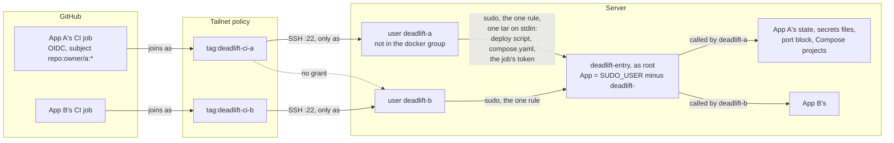
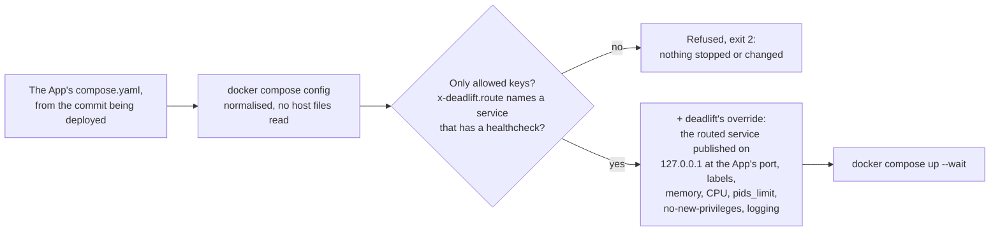
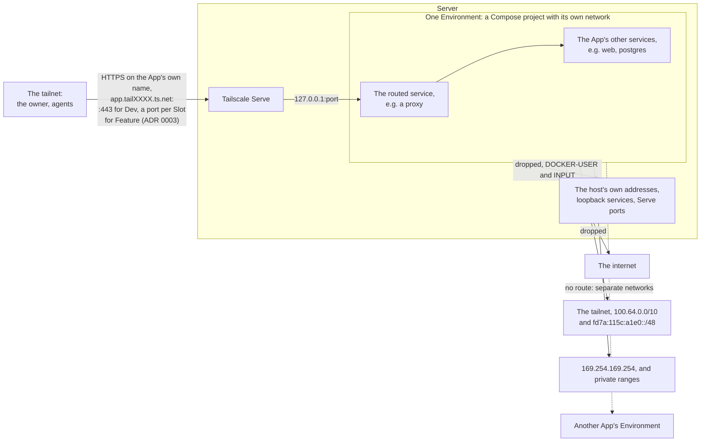

# Apps on a Server are isolated from each other, and an App trusts its own deliveries

Several Apps share one Server, and every delivery carries a Compose template from the commit being deployed, which the Docker daemon runs as root. Guarding only against accidents is enough for a single App on its own Server. With several Apps on one Server, it would let any commit one App delivers read another App's secrets and data. We decided on two levels of trust:

- **Within an App, whatever its CI delivers is trusted.** Any commit the App's CI deploys can change the App's own Compose template, and so its own Environments, the Dev Environment included. Guarding against that would cost every App a manual step on each release.
- **Between Apps on a Server, nothing is trusted.** One App's CI, or a container it runs, can't reach another App's state, secrets, volumes or addresses, short of a kernel escape.

Rootless Docker per App and a Server per App would both isolate better. We rejected them because they cost more to run and set up than these rules, which close the realistic paths. No App gets an exception: an App that needs something these rules refuse works around them.

## Who can run what

Each App has its own CI tag and its own deploy user, and the deploy user may run exactly one command as root, the entry command, through one `sudo` rule:

```text
deadlift-myapp ALL=(root) NOPASSWD: /usr/local/sbin/deadlift-entry
```

The rule names no arguments, so the operation and its arguments are the entry command's to check. It works out the App from the user who called it (`SUDO_USER`, here `deadlift-myapp`), so a deploy user can only ever act on its own App, whatever arguments it passes. The deploy user isn't in the `docker` group, so the entry command pulls the App's images too, with the job's short-lived token sent inside the delivery and removed after.



## What a Compose template may hold

deadlift doesn't generate Compose: the App's one `compose.yaml` holds everything it runs, and deadlift polices it. The template is normalised with `docker compose config`, then checked against an allowlist of keys. Anything outside the allowlist is refused before anything stops. deadlift then adds its own override file for what it owns.



Refused, because each one reaches past the App's own Compose project:

- Host files: bind mounts, `env_file`, `include`, `extends`, and `secrets` or `configs` that read a file. Compose reads these as root.
- Named volumes with `driver_opts`, which can be bind mounts in disguise.
- `privileged`, added capabilities, `devices`, `security_opt` loosening, and the host's network, PID, IPC, UTS or user namespace.
- Networks or containers from outside the project (`external`, `container:`, `volumes_from` another project).
- The Docker socket, in any form.
- `build`: images only.
- Published `ports`: only deadlift publishes, and only the routed service, on the host's loopback.

The Docker daemon also runs with `userns-remap`, so root inside any container is an unprivileged user on the host, whatever the image does.

## What a container can reach

Each Environment is reached through one routed service, which may be a proxy in front of the App's other services. Tailscale Serve is the only way in from the tailnet.



Without the dropped routes, one App's Environment could open another App's Environments through the host's tailnet address.

## Consequences

- An App can't use bind mounts, host files, `build`, extra capabilities, the Docker socket or its own published ports. An App that needs one of them works around it or doesn't use deadlift.
- Every App needs its own Tailscale tag, SSH rule, federated credential and deploy user. Adding an App walks through these.
- Within an App, whoever can get a commit delivered controls that App's Environments and their data.
