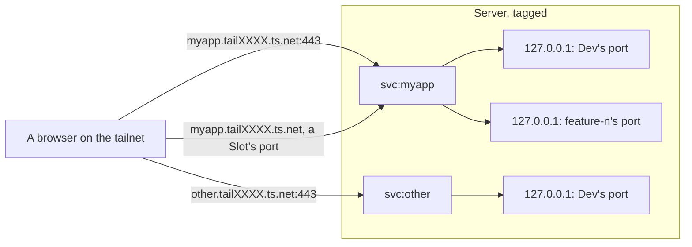

# Each App is reached at its own Tailscale Service name

With several Apps on one Server, only one of them could have the Server's plain HTTPS address, and every other Environment would be a port on the Server's name. We decided that each App gets its own Tailscale Service, `svc:<app>`, served by the Server, so each App has its own name on the tailnet with HTTPS that browsers trust:

- the Dev Environment at `https://<app>.tailXXXX.ts.net/`
- each Feature Environment at a port on that same name, `https://<app>.tailXXXX.ts.net:<port>/`, the port following its Slot

No App is special, so there is no default App. On the Server, deadlift maps each address to the routed service's port on the host's loopback with `tailscale serve --service=svc:<app>`. The loopback ports stay unique per Server, in a block per App, but they're never part of a URL.

Adding an App creates its Service, from the owner's computer, so the Server still holds no Tailscale credential. The tailnet policy needs no change per App for its Service: one `autoApprovers` entry approves every Service tagged for deadlift on a deadlift Server, and one grant by that tag lets the tailnet reach them all.

## Considered Options

- **Ports on the Server's name, with one default App on :443.** Rejected: every App but one gets port URLs, and the URL doesn't say which App it is.
- **A Tailscale sidecar node per App or per Environment.** Rejected: the Server would have to keep a Tailscale credential to create nodes, a node recreated after a crash comes back named `<name>-1`, and a node per Feature Environment would use up the tailnet's 50 certificates a week.
- **A subdomain per Environment, `feature-42.<server>.tailXXXX.ts.net`.** Not available yet: it depends on Tailscale's `dns-subdomain-resolve`, which hadn't rolled out as of 2026-11, and a wildcard certificate that `tailscale serve` can't use, so the Server would also need its own reverse proxy. Worth revisiting once it ships.

## Consequences

- A tailnet has at most 10 Tailscale Services, so at most 10 Apps across all its deadlift Servers. We'll deal with that limit when we reach it.
- The Server must be tagged and run Tailscale 1.86 or later. Devices on Linux with Tailscale 1.93 or earlier need `--accept-routes` to reach a Service.

## Verified

Checked on 2026-11-13 with Tailscale 1.104.7, on a tagged host serving one test Service:

- **Feature Environments on extra ports of one Service: yes.** Serving a port the Service's definition doesn't list worked, and so did adding and removing ports while it ran, with no approval and no interruption to 443. deadlift still lists the Dev port and every Slot's port in the definition, so nothing changes if Tailscale starts enforcing the list.
- **Auto-approval by tag: yes.** With `autoApprovers` keyed on the Service's tag, the host was approved as soon as it served the Service, with no human.
- **Grants by tag: yes.** A grant whose `dst` names the Services' tag, with no grant for the Service by name, let a tailnet device reach it.
- **Federated credentials: the API accepts a GitHub federated credential with only the `services` scope.** Creating a Service through one wasn't tried, which only matters if adding an App ever moves into CI.
- **Creating a Service through the API** works with a body of `name`, `comment`, `ports` and `tags`, and returns the Service's own tailnet addresses.
- **A new Service can take some seconds to become reachable** after its host first serves it.
