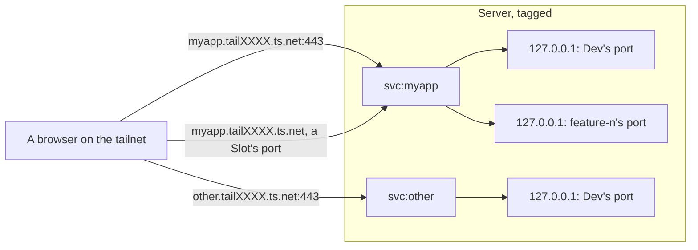

# Each App is reached at its own Tailscale Service name

With several Apps on one Server, only one of them could have the Server's plain HTTPS address, and every other Environment would be a port on the Server's name. We decided that each App gets its own Tailscale Service, `svc:<app>`, served by the Server, so each App has its own name on the tailnet with HTTPS that browsers trust:

- the Dev Environment at `https://<app>.tailXXXX.ts.net/`
- each Feature Environment at a port on that same name, `https://<app>.tailXXXX.ts.net:<port>/`, the port following its Slot

No App is special, so there is no default App. On the Server, deadlift maps each address to the routed service's port on the host's loopback with `tailscale serve --service=svc:<app>`. The loopback ports stay unique per Server, in a block per App, but they're never part of a URL.

Adding an App creates its Service, from the owner's computer, so the Server still holds no Tailscale credential. The tailnet policy auto-approves Services tagged for deadlift on the deadlift Server, and grants access to each one.

## Considered Options

- **Ports on the Server's name, with one default App on :443.** Rejected: every App but one gets port URLs, and the URL doesn't say which App it is.
- **A Tailscale sidecar node per App or per Environment.** Rejected: the Server would have to keep a Tailscale credential to create nodes, a node recreated after a crash comes back named `<name>-1`, and a node per Feature Environment would use up the tailnet's 50 certificates a week.
- **A subdomain per Environment, `feature-42.<server>.tailXXXX.ts.net`.** Not available yet: it depends on Tailscale's `dns-subdomain-resolve`, which hadn't rolled out as of 2026-11, and a wildcard certificate that `tailscale serve` can't use, so the Server would also need its own reverse proxy. Worth revisiting once it ships.

## Consequences

- A tailnet has at most 10 Tailscale Services, so at most 10 Apps across all its deadlift Servers. We'll deal with that limit when we reach it.
- The Server must be tagged and run Tailscale 1.86 or later. Devices on Linux with Tailscale 1.93 or earlier need `--accept-routes` to reach a Service.

## Unverified

These weren't confirmed from Tailscale's documentation. The run on a throwaway Server must settle them before any App relies on them:

- **A Service serving Feature Environments on extra ports.** A Service's definition lists its ports (or `do-not-validate`), and it isn't documented whether one Service can serve HTTPS on many ports that come and go with Slots, or whether each port needs approving. If not, Feature Environments go back to ports on the Server's own name.
- **Auto-approval by tag**: whether `autoApprovers` keyed on the Service's tag approves a newly defined Service on the Server without a human.
- **Grants by tag**: whether a grant's `dst` can name Services by tag. If not, adding an App adds a grant for its `svc:<app>`.
- **Federated credentials**: whether a Tailscale federated credential can create Services. This only matters if adding an App ever moves into CI.
